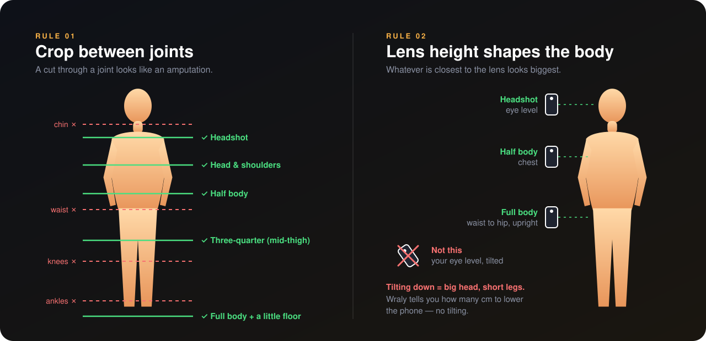
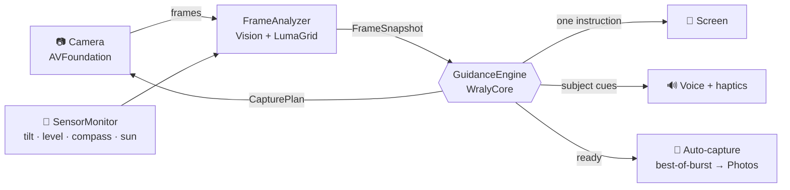

<p align="center">
  
</p>

<p align="center">
  
  
  
  
</p>

<p align="center">
  <b>Hand anyone your phone. Wraly turns them into a portrait photographer.</b><br>
  <sub>It reads the light, checks the background, places the lens at the right height,<br>
  coaches the subject's pose — and takes the shot the moment everything lines up.</sub>
</p>

<p align="center">
  <a href="#-a-shoot-with-wraly">A shoot with Wraly</a> ·
  <a href="#-what-it-sees">What it sees</a> ·
  <a href="#-the-pro-rulebook">Pro rulebook</a> ·
  <a href="#-quick-start">Quick start</a> ·
  <a href="#-under-the-hood">Under the hood</a> ·
  <a href="#%EF%B8%8F-roadmap">Roadmap</a>
</p>

---

## 📸 A shoot with Wraly

> You open Wraly and point it at a friend in a park at 6 pm. Over the next ten seconds, the screen and the voice say:

| | On your screen | Spoken to your friend |
|:-:|---|---|
| 1 | 🔴 **Lens looks smudged — wipe it** | |
| 2 | 🟡 **Sun in their eyes — turn them side-on to it** | |
| 3 | 🟡 **Step back and zoom to 3×** | |
| 4 | 🟡 **Lower the phone ~25 cm** | |
| 5 | 🟡 **Something's growing out of their head — step sideways** | |
| 6 | | *"Turn your body slightly, face back to me."* |
| 7 | | *"Drop your shoulders and breathe out."* |
| 8 | 🟢 **Perfect — hold it** | *"Hold it."* → 📸 three frames, the sharpest one with open eyes saved |

Each instruction arrives **one at a time, in the order a pro would fix it**: lens → light → lens choice → angle → framing → background → pose → expression. No flicker, no nagging.

---

## ✨ What it sees

<table>
<tr>
<td width="50%" valign="top">

### 🧼 Dirty lens
Soft micro-contrast while focus is locked, **halation** around highlights and **lifted blacks** from veiling glare, averaged over ~3 s so a foggy day doesn't fool it.

### ☀️ Sunlight
Scene EV from aperture, shutter and ISO. The **sun's position** comes from your location, the date and the compass. Wraly knows whether your subject is front-lit (squint risk), side-lit or backlit, and when it's golden hour.

### 🌙 Low light
Under EV 4.5 it suggests a window or lamp. Under EV 1 it's critical. It also lets the shutter go to 1/60 s, raises the ISO cap and shoots a burst.

### 🌄 Background
Clutter, **mergers** (a pole growing out of a head), bright patches at the edges, subject-to-background separation and scene type (snow, beach).

</td>
<td width="50%" valign="top">

### 📏 Height & position
Distance from **pupil spacing**, the subject's **height** from frame span × distance, and centring and **look room** from where the nose points.

### 📐 Where your lens is on their body
An upright lens "sees" its own height at the frame centre. Add the phone's tilt and Wraly knows whether you're at **eye, chest, waist or knee** level, without a depth sensor.

### 🙂 Head & expression
Head tilt, chin up or down, the half-turn where the **nose breaks the cheek line**, and blinks. It never fires on closed eyes.

### 🧍 Shoulders & body
**Squared shoulders**, raised (tense) shoulders, leaning, **arms pressed to the waist**, locked knees and a wide stance.

</td>
</tr>
</table>

---

## 🎓 The pro rulebook

These are the details that separate a professional from someone who owns a good phone. Every one is coded as a rule in [`WralyCore`](WralyCore/Sources/WralyCore).

<p align="center">
  
</p>

<details>
<summary><b>🔭 Lens & perspective</b></summary>

- Perspective comes from **distance**, not focal length. A face shot from 50 cm on 1× gets a bigger nose and smaller ears. Step back to 1.5–3 m and zoom in.
- Ideal focal lengths (full-frame equivalent): **70–135 mm** for headshots, **50–85 mm** for half body, **24–70 mm** for full body.
- Prefer the **optical** stops (0.5× · 1× · 2× · 3–5×). Digital zoom in between throws detail away.
- Never put a person near the edge of the **ultra-wide**. It stretches them.
</details>

<details>
<summary><b>📐 Camera height & tilt</b></summary>

| Shot | Lens height |
|---|---|
| Headshot | eye level or slightly above |
| Head & shoulders | eye to chin |
| Half body | chin to chest |
| Three-quarter | chest to waist |
| Full body | **waist to hip, phone upright** |

- Shooting a full body down from your own eye level gives a **big head and short legs**. Lower the phone instead of tilting it.
- Shooting a face from below shows nostrils and a double chin.
- Level the horizon. Even 2–3° shows on door frames.
</details>

<details>
<summary><b>🖼️ Framing & cropping</b></summary>

- **Never crop at a joint** (chin, elbows, wrists, waist, knees, ankles). Crop between them.
- **Headroom:** 3–12% above the crown. Too much sky over the head is the #1 phone mistake.
- Eyes on the **upper-third line**. Leave **look room** on the side the subject faces.
- Full body: show the feet plus **3–10% floor**.
- Keep hands and elbows off the frame edge.
</details>

<details>
<summary><b>💡 Light</b></summary>

- Read the **shadows on the face** before the brightness of the scene.
- Harsh midday sun → **open shade**, facing open sky.
- Sun behind you → squinting. Turn them side-on or backlit and **expose for the face**.
- **Golden hour** → backlight for a rim of light on the hair. White balance is locked to daylight so the warmth isn't "corrected" away.
- Open shade is blue (7000 K+), so Wraly warms the skin slightly.
- Phone flash is **fill within ~3 m**, never the main light in a dark room.
- Snow and sand fool meters, so Wraly adds +0.7 EV.
- **Meter the face, not the frame.** This works for every skin tone.
</details>

<details>
<summary><b>⚙️ Exposure & focus</b></summary>

- **1/125 s** or faster for people. At long focal lengths, also follow the reciprocal rule (1 / 2×focal) to beat hand shake.
- In dim light, 1/60 s with stabilisation beats high-ISO mush.
- **Focus on the near eye.** In a ¾ view, that's the eye away from where the nose points.
- In tricky light, shoot a burst and keep the sharpest frame **with open eyes**.
</details>

<details>
<summary><b>🧍 Posing (Wraly says these out loud)</b></summary>

- Body **30–45° away**, face turned back to the camera.
- **"Drop your shoulders and breathe out."**
- **Forehead forward, chin down a touch.** The "turtle" defines the jawline.
- A tilt of 5–10° looks relaxed. Much more looks quizzical.
- Avoid the half-turn where the nose breaks the cheek line.
- A **gap between arm and waist**.
- Weight on the **back leg**, front knee soft.
- Blinkers: "Close your eyes… open on three."
</details>

---

## 🚀 Quick start

**You'll need:** Xcode 15.3+ (16 recommended), a real iPhone on iOS 17+ (the simulator has no camera), and [XcodeGen](https://github.com/yonaskolb/XcodeGen).

```bash
git clone https://github.com/AMOSA500/wraly-ios.git
cd wraly-ios
brew install xcodegen
xcodegen generate
open Wraly.xcodeproj
```

Choose your **Team** under *Signing & Capabilities*, select your iPhone and press **Run**.

To run the photography-rules tests without a phone:

```bash
cd WralyCore && swift test
```

---

## 🧠 Under the hood



| Folder | Role |
|---|---|
| [`WralyCore/`](WralyCore) | Pure-Swift package with every photography decision. Seven advisors (framing, angle, lens, light, background, pose, expression), a capture planner, a smudge estimator, a solar calculator and the `GuidanceEngine` that prioritises them all. **Unit-tested.** |
| [`Wraly/Camera`](Wraly/Camera) | Session setup, lens selection, applying focus, exposure and white balance, and burst capture with best-frame picking. |
| [`Wraly/Analysis`](Wraly/Analysis) | Vision requests (body pose, face landmarks, capture quality, person segmentation, scene classification), a 72×96 luma grid for pixel statistics, and the motion and compass sensors. |
| [`Wraly/Coaching`](Wraly/Coaching) | Glue, auto-capture, speech and haptics. |
| [`Wraly/UI`](Wraly/UI) | Viewfinder, thirds grid, headroom band, pose skeleton, level line, lens-height ruler and details sheets. |

**Privacy:** everything runs on the phone. Location is used only to compute the sun's angle and never leaves the device.

---

## 🎛️ Calibrate on a device

The thresholds are reasoned starting points. Tune them with real people before shipping:

- [ ] `FrameAnalyzer.facePitchSign`: lift your chin and check that *"Bring your chin down"* fires
- [ ] `LensSmudgeEstimator`: log the score with a clean lens and with a deliberate fingerprint
- [ ] `PoseAdvisor`: the squared-shoulder ratio (2.35) and neck gap (0.16 heads) vary with build and clothing
- [ ] `LightingAdvisor`: compare EV bands against a light-meter app
- [ ] Sun direction: check that the compass heading tracks the lens outdoors

---

## 🗺️ Roadmap

- [ ] LiDAR / depth distance on Pro models (`FrameSnapshot.depthDistance` is already wired)
- [ ] Core ML smudge classifier trained on clean and dirty lens pairs
- [ ] Group mode: one focus plane for all faces, staggered head heights
- [ ] Aesthetics scoring for burst picking (iOS 18)
- [ ] Apple Watch remote, so the subject sees the coaching too

---

<p align="center">
  <sub>Made for everyone who has ever been handed a phone and asked <i>"can you take one of me?"</i></sub>
</p>
